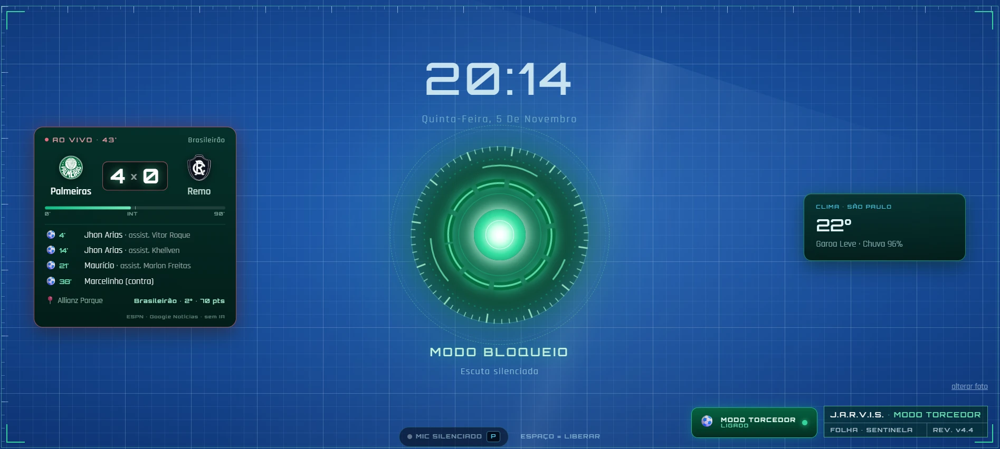
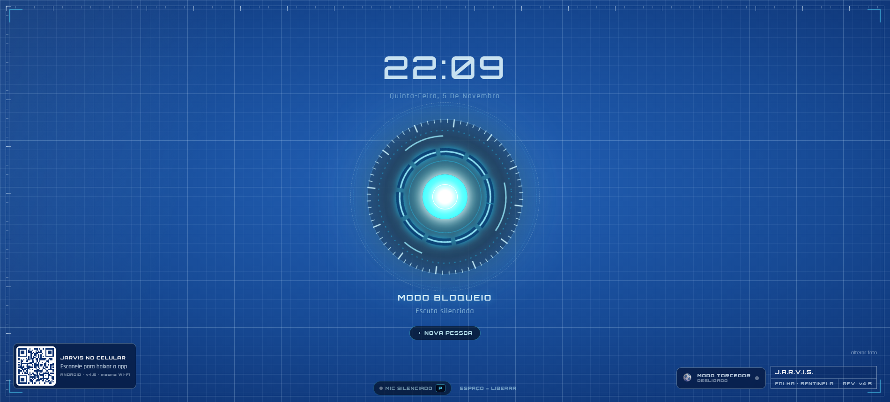
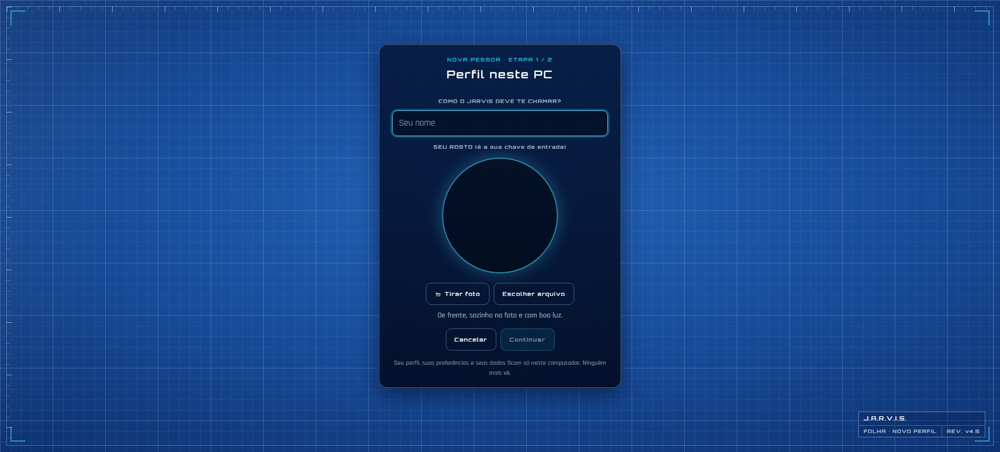

# JARVIS 5.0.0 — Assistente pessoal para Windows

<p align="center">
  
</p>

[](https://github.com/PatrickCaramico/IA_Jarvis/actions/workflows/ci.yml)

Assistente pessoal local, em português, com comandos de voz, desbloqueio por rosto ou PIN e uma central para tarefas, agenda, hidratação, música e automações. O JARVIS usa o provedor de IA que você configurar e mantém os dados pessoais no PC.

## Capturas

<p>
  
  
</p>
<p>
  
  
</p>

## O que o JARVIS faz

- Conversa por voz ou texto e executa comandos no Windows.
- Protege a central com reconhecimento facial, PIN e perfis separados.
- Organiza tarefas, lembretes, agenda, notas e hidratação.
- Abre sites cadastrados em **Configurações > Meus Sites** por nome ou apelido.
- Exibe agenda e placar do Palmeiras no Modo Torcedor, incluindo escudos com cache local.
- Oferece app Android para acessar a central na mesma rede Wi-Fi.
- Verifica releases no PC e oferece download de APK novo no Android, sem instalar atualizações automaticamente.

## Identidade visual: o Branding Book


O JARVIS tem um Branding Book próprio: personalidade e tom de voz ("um mordomo digital: competente,
discreto e leal"), o logo **Núcleo** e o kit de logo, cores com contraste medido, fontes, sons e estados
da interface, a planta blueprint, o Modo Torcedor e o histórico de cada versão, da V1 à 5.0.

| Cor | Hex | Uso |
| --- | --- | --- |
| Núcleo Ciano | `#22D3EE` | Cor principal: logo, bordas e destaques |
| Âmbar Sentinela | `#F59E0B` | Modo Sentinela, avisos e foco |
| Verde Confirmação | `#10B981` | Acesso liberado e ação concluída |
| Vermelho Crítico | `#EF4444` | Erro e acesso negado |
| Planta | `#174A95` | Fundo blueprint da central |
| Abismo | `#05070D` | Fundo escuro |

Fontes: **Orbitron** (títulos), **Rajdhani** (interface), **Inter** (texto) e **JetBrains Mono** (dados).

- **Ler no GitHub:** [docs/BRANDING-BOOK.md](docs/BRANDING-BOOK.md)
- **Versão ilustrada e animada:** [docs/branding-book.html](docs/branding-book.html). Baixe o arquivo e
  abra no navegador (o GitHub mostra só o código da página).

## Site de apresentação (Netlify)

A vitrine do JARVIS fica em `site/` e é publicada no Netlify: apresentação, capturas, o Branding Book
ilustrado (em `/branding-book.html`) e os links para o GitHub e para o app Android. É só um site estático;
o JARVIS continua rodando no seu PC, e nenhum dado ou chave passa por ele.

- **Montar e ver no PC:** `bash scripts/netlify/montar_site.sh` gera a pasta `_site/`; abra com
  `python -m http.server 5199 --directory _site` e acesse `http://127.0.0.1:5199`.
- **Publicar:** no Netlify, *Add new site > Import an existing project > GitHub* e escolha este repositório.
  O `netlify.toml` já diz o comando e a pasta; não é preciso preencher nada. Cada envio ao `main` atualiza o site.
- **Endereços curtos:** `/branding` (Branding Book), `/app` (última versão do APK) e `/github`.

## Requisitos

- Windows 10 ou 11.
- Git para clonar o repositório.
- Python 3.11 ou mais novo.
- Node.js 20 ou mais novo e npm.
- Uma chave de API para o provedor de IA escolhido: Gemini, OpenAI ou Anthropic.
- Google Chrome atualizado; webcam e microfone são opcionais, mas necessários para reconhecimento facial e voz.

Para gerar o APK localmente, também são necessários JDK 17, Android SDK 34 (Build Tools 34.0.0) e FFmpeg.

## Instalação a partir do clone

No PowerShell:

```powershell
git clone https://github.com/PatrickCaramico/IA_Jarvis.git
Set-Location IA_Jarvis
Copy-Item .env.example .env
notepad .env
```

No `.env`, selecione o provedor em `LLM_PROVIDER` e preencha a chave correspondente. Não compartilhe nem envie o `.env` ao GitHub.

Depois, inicie o JARVIS:

```powershell
.\Iniciar-JARVIS.bat
```

Na primeira execução, o script prepara o ambiente Python e instala as dependências do frontend. O painel abre em `http://127.0.0.1:5173`. Para encerrar, use `Parar-JARVIS.bat`.

A mesma central também abre pelo site, no botão **Abrir meu JARVIS** (`https://projeto-jarvis-ia.netlify.app/app/`), e conversa com o JARVIS ligado no PC. Para o site conseguir ligar o JARVIS quando ele estiver desligado (botão **LIGAR O JARVIS**), rode uma vez o `Instalar-Botao-Ligar.bat`: ele cria o atalho `jarvis://` só para o seu usuário do Windows, que roda o `Iniciar-JARVIS.bat` sem abrir aba nova. O navegador pergunta antes de abrir. Para desfazer, use `Remover-Botao-Ligar.bat`.

Depois de uma atualização no GitHub, toque em **⟳ ATUALIZAR** na tela de bloqueio: o JARVIS baixa a versão nova, avisa por voz e reinicia sozinho.

**Alarmes e lembretes por voz (V5.1):** "Jarvis, me acorda às 7", "alarme de segunda a sexta às 6 e meia", "me lembra toda terça às 19 de levar o lixo". Tocando, diga "Jarvis, parar" ou "soneca". Lista completa em `docs/COMANDOS.md`.

**Esqueci o PIN:** no teclado do PIN (ou em Configurações › Bloqueio), "Esqueci o PIN" confirma o seu rosto e libera um PIN novo. Sem câmera, rode o `Redefinir-PIN.bat`.

**Celular:** com o JARVIS ligado, abra no navegador do celular `http://<IP do PC>:8000/api/mobile` (mesma Wi-Fi), baixe e instale o `JARVIS.apk` e conecte com o endereço do PC e o seu PIN. Com o app 5.1.1 ou mais novo instalado, o QR abre o app direto e ele se atualiza sozinho quando o PC tiver versão nova.

## App Android

Baixe `JARVIS-<versão>.apk` na [página de Releases](https://github.com/PatrickCaramico/IA_Jarvis/releases/latest) ou inicie o JARVIS em modo de rede e escaneie o QR da Sentinela. O celular e o PC precisam estar na mesma rede Wi-Fi; o pareamento é feito com o PIN do perfil principal.

## Documentação

| Documento | Conteúdo |
| --- | --- |
| [docs/ATUALIZACAO-V5.md](docs/ATUALIZACAO-V5.md) | Novidades da versão 5.0.0 |
| [docs/COMANDOS.md](docs/COMANDOS.md) | Comandos de voz, atalhos e operação diária |
| [docs/CONFIGURACAO.md](docs/CONFIGURACAO.md) | `.env` e configurações do painel |
| [docs/API.md](docs/API.md) | Rotas, acesso e endpoints do backend |
| [docs/ARQUITETURA.md](docs/ARQUITETURA.md) | Componentes e estrutura do projeto |
| [docs/RELEASE.md](docs/RELEASE.md) | Secrets e publicação de APKs assinados |
| [CHANGELOG.md](CHANGELOG.md) | Histórico de versões |
| [LICENSE](LICENSE) | Licença MIT |
| [docs/BRANDING-BOOK.md](docs/BRANDING-BOOK.md) | Identidade visual e componentes da interface (versão ilustrada em [docs/branding-book.html](docs/branding-book.html)) |

## Desenvolvimento

```powershell
python -m pip install -r backend/requirements.txt -r backend/requirements-dev.txt
python -m ruff check backend
python -m pytest -q backend/tests scripts/tests
Set-Location frontend
npm ci
npm test
npm run lint
npm run build
```
