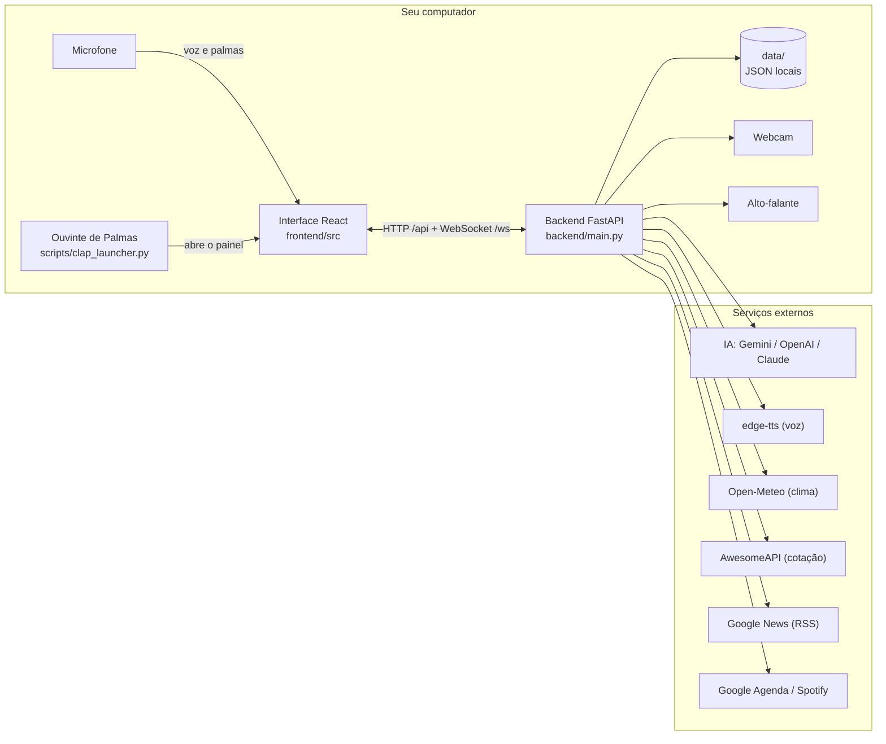
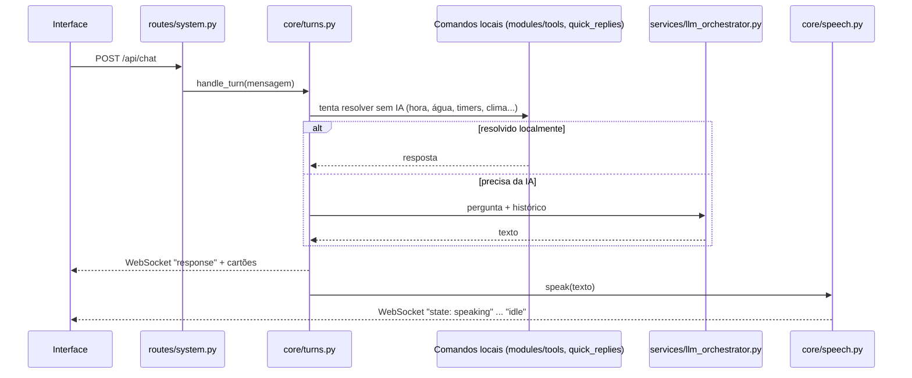
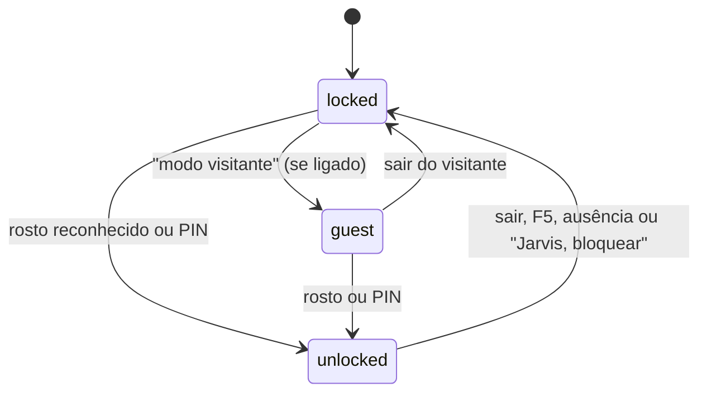

# Arquitetura do JARVIS (v4.4)

O JARVIS tem duas partes que rodam no seu PC: o **backend** em Python (FastAPI, porta 8000) e a
**interface** em React (Vite, porta 5173). Elas conversam por HTTP (`/api/...`) e por um WebSocket
(`/ws`) que leva os eventos em tempo real (estado, fala, câmera ao vivo, água).

## Visão geral

O reconhecimento de voz (microfone) roda no navegador; a câmera, a voz do JARVIS e as chaves de
API ficam só no backend. Nenhuma chave vai para a interface.

## Backend (`backend/`)

| Pasta / arquivo | Papel |
| --- | --- |
| `main.py` | Só monta o app: log, middleware de segurança (token e bloqueio), CORS e inclusão das rotas. |
| `routes/` | Uma APIRouter por área: `system`, `access`, `profile`, `water`, `productivity`, `info`, `search`, `fan`, `integrations`, `health`. Referência completa em [API.md](API.md). |
| `core/session.py` | Estado da conversa: ocupado, turno atual, histórico. Sempre lido como `session.<nome>`. |
| `core/runtime.py` | Token de acesso, conexões WebSocket (`manager`) e tarefas em segundo plano (`track`). |
| `core/speech.py` | Fala com estados da tela, avisos falados, volume noturno e frases fixas no cache de voz. |
| `core/turns.py` | Motor de conversa: comandos locais primeiro, depois a IA; modo restrito do bloqueio. |
| `core/reactive_cards.py` | Cartões que acompanham a resposta (clima, cotação, agenda, água...). |
| `core/briefing_flow.py` | V4.3: "bom dia" em etapas. Fala cada assunto e envia o card dele (`briefing_start`, `briefing_step`, `briefing_end`); os dados vêm de `modules/briefing.py`, a triagem de e-mail de `modules/email_triage.py`. |
| `core/watchers.py` | Laços de serviço: dia de jogo do Modo Torcedor e lembrete de água. |
| `modules/` | Funções de cada recurso (tarefas, lembretes, foco, água, rosto, PIN, Spotify, sistema...). |
| `services/llm_orchestrator.py` | Monta o pedido e chama o provedor de IA escolhido (clientes reaproveitados). |
| `services/http_client.py` | Cliente HTTP único: timeout, nova tentativa em falhas temporárias e cache curto. |
| `services/quotes.py` | Cotação de moedas em um só lugar (cache de 60 s). |
| `modules/diagnostics.py` | Diagnóstico sem segredos (V4.2.2): mascara chaves, tokens e e-mails e omite o texto dos pedidos. |
| `version.py` | Versão única do backend (`/api/health`, FastAPI, diagnóstico). |
| `config/settings.py` | Lê o `.env`. Lista de variáveis em [CONFIGURACAO.md](CONFIGURACAO.md). |
| `tests/` | Testes com pytest. |

### Caminho de uma pergunta

A fala é dividida em partes: a primeira é curta para o som começar antes, e as seguintes são
sintetizadas enquanto a anterior toca.

### Bloqueio real

O estado de acesso (`locked`, `unlocked` ou `guest`) vive em `modules/access.py`. O middleware de
`main.py` consulta `access.is_allowed()` em toda chamada `/api`: com a central bloqueada, só as rotas
públicas respondem (negação por padrão); as outras devolvem 403 `{"code": "locked"}`. A coluna
"Acesso" do [API.md](API.md) mostra a regra de cada rota.

## Interface (`frontend/src/`)

| Pasta / arquivo | Papel |
| --- | --- |
| `main.jsx` | Entrada: abre o `App` ou a tela secundária (`/display`). |
| `App.jsx` | Telas (boot, cadastro, bloqueio, central), conversa, microfone, palmas e Sentinela. |
| `components/` | Widgets e telas (HUD, tela de bloqueio, água, configurações...). |
| `hooks/` | `useJarvisSocket` (WebSocket), `useClapDetector`, `useSentinelListener`, `useSpeechRecognition`, `useSearchIndicator`, `usePolling`, `useNow`. |
| `utils/api.js` | Endereço do backend, token e chamadas JSON. |
| `utils/polling.js` | Buscas periódicas que param com a aba oculta. |
| `utils/clock.js` | Relógio central (um timer para todos os relógios). |
| `utils/lazyComponent.jsx` | Carrega telas pouco usadas só quando abertas. |
| `utils/soundEffects.js` | Sons sintetizados (V4.2.2): estados ouvindo, sucesso, erro e repouso; `soundPolicy` decide volume, modo e silêncio das 22h às 7h. |
| `components/ui/` | `Skeleton` e `EmptyState` (carregando e vazio nos widgets) e `OfflineBanner` (servidor fora do ar). Estilos em `feedback.css`. |
| `components/NowPlaying.jsx` | Cartão "Tocando agora" do Spotify (bloqueio sem botões, central com controles). |
| `components/WelcomeLogo.jsx` | Boas-vindas com o Núcleo animado; o nome em traço vem de `utils/wordmark.js` (o mesmo do kit de logo). |
| `utils/version.js`, `utils/tabTitle.js` | Versão mostrada na interface e título da aba com o estado do orbe. |
| `../public/brand/` | Kit de logo (avatar, banner, compartilhamento), gerado por `scripts/dev/gerar_kit_logo.py`. |
| `../tests/` | Testes com `node --test`. |

## Dados locais (`data/`)

Tudo fica em arquivos JSON no seu PC: preferências (`jarvis_settings.json`), tarefas, lembretes,
memória, água, registro de acesso, PIN (só o hash, nunca o número), foto de perfil e tokens das
integrações. O `.gitignore` deixa a pasta fora do Git (só `atalhos.json` é versionado) e o
`Backup-Dados.bat` faz cópia dela.
