# Branding Book do JARVIS (v1.13, atualizado na V5.4.0 em 11/11/2026: entrada sem repetição, janela do perfil e QR que abre o app; entrada direta para quem já usa, reconexão sozinha e central enxuta no celular)

Versão aprovada do Branding Book proposto no plano da 4.2. Há também uma versão ilustrada e animada: abra `docs/branding-book.html` no navegador. Tudo aqui já está aplicado no projeto;
no fim de cada seção há onde isso vive no código.

## 1. Identidade e personalidade

O JARVIS é um mordomo digital: competente, discreto e leal, com humor seco na medida certa. Ele
resolve antes de explicar e nunca faz o usuário se sentir burro.

**Posicionamento:** a central pessoal que cuida da sua rotina, do seu foco e da sua saúde, rodando no
seu próprio PC, com seus dados protegidos atrás do seu rosto.

**Arquétipo:** Sábio + Cuidador. O Sábio traz precisão e conhecimento; o Cuidador traz atenção à
água, ao foco e ao descanso. A pitada de humor vem do Bobo da Corte, usada com parcimônia.

### Valores

| Valor | Como aparece no produto |
| --- | --- |
| **Discrição** | Bloqueio por rosto e PIN, nada pessoal na tela de bloqueio ou para visitantes |
| **Prontidão** | Responde rápido, acorda por palma ou pela palavra de ativação (Modo Sentinela) |
| **Precisão** | Dados com fonte e horário; diz quando não sabe |
| **Cuidado** | Lembretes de água e pausas no ritmo certo, sem insistir |
| **Lealdade** | Trabalha para um dono só; os dados ficam no PC dele |

### Tom de voz

| Sempre | Nunca |
| --- | --- |
| Formal e cordial, trata por "senhor" (ou pelo nome, se configurado) | Gírias pesadas, emojis ou excesso de exclamações |
| Frases curtas; a resposta vem primeiro, o detalhe depois (1 a 3 frases faladas) | Parágrafos longos para algo que cabe numa frase |
| Educado como um assistente de voz: "Claro, senhor.", "Com prazer.", agradece quando agradecem | Responder seco ou ignorar um "obrigado" |
| Quando pesquisou na internet, diz a fonte em poucas palavras ("segundo o ge") | Dar notícia sem dizer de onde veio |
| Humor seco e sutil, no máximo uma tirada por resposta | Piadas em momentos de erro, alerta ou bloqueio |
| Assume o erro com calma e oferece o próximo passo | Culpar o usuário ou dar desculpas técnicas |
| Pergunta antes de ações irreversíveis | Agir sozinho em arquivos, compras ou mensagens |

### Exemplos

| Situação | Assim | Não assim |
| --- | --- | --- |
| Lembrete de água | "Hora de um copo d'água, senhor. Hoje foram 800 de 2000 ml." | "Você esqueceu de beber água de novo!!!" |
| Pedido bloqueado | "Para isso preciso liberar a central. Posso escanear seu rosto?" | "Acesso negado." |
| Erro de API | "O serviço de clima não respondeu. Tento de novo em um minuto." | "Erro 503: Service Unavailable" |
| Bom dia | "Bom dia, senhor. 24°, sem chuva, e três tarefas para hoje." | "Olá! Como posso te ajudar hoje? 😊" |
| Abertura do briefing | "Revisei o que já está consolidado e nada exige interromper a sua manhã." | "Vamos lá! Tenho MUITA coisa pra te contar hoje!" |
| Notícia | "Em tecnologia: nova geração de chips dobra a autonomia. A informação é do Tecmundo." | Ler a manchete sem dizer de onde veio |
| Saúde | "Seus dados de saúde estão disponíveis sob demanda." | "Você dormiu só 5 horas e seu batimento está alto." (em voz alta, sem você pedir) |
| Fechamento do dia | "Deixe o guarda-chuva separado para amanhã e descanse bem." | "Boa noite!!! Durma bem!!! 😴" |

Exceção: o Modo Torcedor mantém o próprio estilo de torcida ("Avante Palestra!", "Bora Palmeiras!").

**No código:** prompt da IA em `backend/services/llm_orchestrator.py` (`SYSTEM_PROMPT`) e frases fixas
nos módulos do backend.

## 2. Nomes

| Item | Nome aprovado |
| --- | --- |
| Assistente | JARVIS (o nome da IA pode ser trocado em Configurações) |
| Módulo de escuta contínua | **Modo Sentinela** (mantido; as siglas propostas não foram adotadas) |
| Versão exibida na central | `v5.4.0` (sem referências a marcas de terceiros, como "Stark") |
| Lista de sites abertos por voz | **Meus Sites** (Configurações > Meus Sites) |
| Resumo da manhã | **Briefing** (disparado por "bom dia") |
| Resumo da noite | **Fechamento do dia** (disparado por "boa noite") |
| Uma tela por tema | **Telas por assunto** ("notícias", "notificações", "e-mails", "agenda", "clima", "tarefas", "meus dados de saúde", "comandos") |
| Faixa de atalhos falados | **DIGA:** (embaixo do orbe) |
| Botão de pular | **PRÓXIMO ▸** (ou a seta →) |

## 3. Logo: conceito "Núcleo"

Um círculo central com dois anéis segmentados em volta: o anel interno com 3 segmentos e o externo
com 4. A metáfora é energia sempre ligada, o coração da central. O desenho é original e não
reproduz o reator nem marcas da Marvel, então pode aparecer nos vídeos do canal.

Regras de uso:
- legível a 16 px (ícone da aba do navegador);
- versão de uma cor só: o componente usa a cor do texto (`currentColor`);
- área de respiro igual à altura do núcleo;
- funciona sobre fundo claro e escuro; na interface, os anéis podem girar devagar (param com "reduzir movimento" ligado no sistema).

Medidas (grade de 64 × 64): núcleo com raio 8; anel interno com raio 17, traço 3,5 e 3 segmentos;
anel externo com raio 26, traço 2,5 e 4 segmentos.

**No código:** `frontend/public/jarvis-logo.svg` (ícone, com fundo Abismo) e
`frontend/src/components/JarvisLogo.jsx` (componente usado no topo da central).

### Kit de logo (V4.2.2)

O nome **JARVIS** ganhou um desenho próprio em traço: letras geométricas, traço 9 numa grade de
56 × 72, cantos chanfrados. Por ser desenho e não fonte, sai igual em qualquer computador.

| Peça | Tamanho | Arquivo (`frontend/public/brand/`) | Uso |
| --- | --- | --- | --- |
| Avatar | 512 e 1024 px | `avatar.svg`, `avatar-512.png`, `avatar-1024.png` | Foto de perfil; o logo fica no centro e aguenta recorte redondo |
| Banner | 1500 × 500 | `banner.svg`, `banner-1500x500.png` | Capa de perfil; o conteúdo fica no centro (área segura do YouTube) |
| Compartilhamento | 1200 × 630 | `share.svg`, `share-1200x630.png` | Imagem que aparece ao compartilhar um link |
| Nome em traço | livre | `wordmark.svg` | Vídeos, abertura e assinatura |
| Boas-vindas | tela | `components/WelcomeLogo.jsx` | Os anéis entram girando, o núcleo acende e o nome se desenha; parado com "reduzir movimento" |

Assinatura usada nas peças: **CENTRAL PESSOAL · ROTINA, FOCO E SAÚDE**.

**No código:** gerado por `scripts/dev/gerar_kit_logo.py` (rode de novo se mudar o logo); as letras
ficam também em `frontend/src/utils/wordmark.js`, e um teste confere que as duas são iguais.

## 4. Paleta de cores

Contraste medido pela regra WCAG sobre o fundo `#05070D`, ou sobre o painel quando o fundo é a planta
(ver abaixo); 4,5:1 é o mínimo para texto comum.

| Cor | Hex | Token CSS | Uso | Contraste |
| --- | --- | --- | --- | --- |
| Núcleo Ciano | `#22D3EE` | `--j-core` | Cor principal: logo, bordas, destaques, estado de escuta | 11,1:1 |
| Ciano Profundo | `#0E7490` | `--j-deep` | Brilhos, linhas de grade, preenchimentos; nunca em texto | 3,8:1 |
| Âmbar Sentinela | `#F59E0B` | `--j-amber` | Modo Sentinela, avisos, estado de fala | 9,4:1 |
| Verde Confirmação | `#10B981` | `--j-green` | Acesso liberado, ação concluída, meta batida | 7,9:1 |
| Vermelho Crítico | `#EF4444` | `--j-red` | Acesso negado, erro, alerta de sistema | 5,4:1 |
| Texto Principal | `#E6F7FB` | `--j-text` | Texto e números | 18,3:1 |
| Texto Secundário | `#7FA7B5` | `--j-muted` | Legendas, rótulos, horários | 7,8:1 |
| Painel | `#0B1220` | `--j-panel` | Fundo de cartões e menus | — |
| Abismo | `#05070D` | `--j-abyss` | Fundo geral | — |

Proporção sugerida: cerca de 70% de fundos escuros, 20% de ciano e 10% para âmbar, verde e vermelho,
que só aparecem quando significam algo.

**Planta (V4.4).** Com o fundo blueprint, o "fundo" passa a ser papel azul e os painéis continuam
escuros. Contraste medido do Texto Principal (`#E6F7FB`) sobre cada tom:

| Cor | Hex | Uso | Texto Principal sobre ela |
| --- | --- | --- | --- |
| Planta Clara | `#2362B8` | Centro do papel (o brilho) | 5,4:1 |
| Planta | `#174A95` | Papel | 7,8:1 |
| Planta Funda | `#0D3170` | Bordas do papel (vinheta) | 11,3:1 |
| Linha Forte | branco a 17% | Grade a cada 100 px | — |
| Linha Fina | branco a 7,5% | Grade a cada 20 px | — |
| Vidro Torcedor | `#022C1A` | Painéis no Modo Torcedor (verde `#6EE7B7` sobre ele: 10,0:1) | 13,8:1 |

Regra: sobre o papel, só texto branco (Texto Principal). Ciano e verde em texto ficam **dentro** dos
painéis escuros: direto no centro claro da planta eles não passam de 3,3:1.

**No código:** tokens em `frontend/src/brand.css`; o tema azul padrão
(`backend/modules/prefs.py`, `THEMES["blue"]`) usa Núcleo Ciano, Ciano Profundo e Abismo.

## 5. Tipografia

| Função | Fonte | Uso |
| --- | --- | --- |
| Títulos e marca | **Orbitron** | Nome JARVIS, títulos de painel, rótulos em maiúsculas (só textos curtos) |
| Interface | **Rajdhani** | Botões, menus, cartões |
| Texto longo | **Inter** | Respostas do JARVIS, configurações, documentação |
| Dados | **JetBrains Mono** | Relógio, CPU, temperaturas, valores em ml e moedas |

Todas são gratuitas no Google Fonts.

**No código:** fontes carregadas em `frontend/index.html`; variáveis `--font-title`, `--font-ui`,
`--font-text` e `--font-data` em `frontend/src/brand.css`.

## 6. Aplicações de interface

Cada estado do JARVIS tem cor e movimento próprios, comunicados pelo orbe central, e o nome do
estado também aparece em texto na HUD (o estado nunca é indicado só pela cor).

| Estado | Cor | Movimento do orbe | Texto na HUD |
| --- | --- | --- | --- |
| **Repouso** | Ciano com brilho baixo | Respiração lenta; na 4.4, só o orbe e a faixa DIGA: na tela | EM ESPERA |
| **Modo Sentinela** | Âmbar Sentinela, brilho baixo | Anel externo gira devagar | "Diga 'Jarvis'" |
| **Ouvindo** | Núcleo Ciano, brilho alto | Fios mais rápidos e brilho forte | OUVINDO |
| **Processando** | Núcleo Ciano | Fios girando rápido; nunca uma barra de progresso falsa | PROCESSANDO |
| **Falando** | Âmbar no centro, ciano nas bordas | Pulso acompanhando a voz | FALANDO |
| **Sucesso** | Verde Confirmação | Um flash e volta ao estado anterior | — |
| **Erro** | Vermelho Crítico | Tremida horizontal curta (0,3 s) | mensagem de erro |

### Diretrizes gerais

- **Cartões:** fundo Painel translúcido, borda de 1 px em ciano suave, cantos de 8 px e brilho só no cartão ativo.
- **Movimento:** transições entre 150 e 300 ms; com "reduzir movimento" ligado, sem rotações nem tremida.
- **Carregamento de dados:** blocos esqueleto em vez de spinners (clima, agenda, Spotify, finanças e notícias); o brilho para com "reduzir movimento".
- **Vazio:** ícone num círculo, uma frase curta e, quando fizer sentido, uma ação ("Agenda livre · Atualizar").
- **Tocando agora (Spotify):** cartão no mesmo vidro dos outros, capa de 44 px, ponto Verde Confirmação e um equalizador de 3 barras só quando está tocando; pausado fica esmaecido.
- **Sem conexão:** faixa âmbar no topo, que fica verde por um instante quando a conexão volta. Quedas de até 3 s não aparecem.
- **Som:** todo som respeita o modo silencioso e dura no máximo 400 ms (ver "Sons por estado").
- **Acessibilidade:** o estado sempre vem acompanhado de texto ou movimento, além da cor.

**No código:** estados do orbe em `frontend/src/components/WireOrb.jsx` e `frontend/src/brand.css`;
o flash de sucesso/erro é disparado em `frontend/src/App.jsx`. Esqueleto, vazio e sem conexão em
`frontend/src/components/ui/` e `frontend/src/feedback.css`.

### Sons por estado (V4.2.2)

Sons sintetizados na hora (sem arquivos), curtos e suaves, que acompanham o orbe.

| Estado | Som | Duração | Toca no modo "Só o que importa" |
| --- | --- | --- | --- |
| **Ouvindo** | Duas notas subindo (sol e ré agudos) | 0,17 s | Não |
| **Sucesso** | Três notas subindo, timbre triangular | 0,25 s | Não |
| **Erro** | Duas notas descendo, timbre triangular | 0,32 s | Sim |
| **Repouso** | Um deslize grave para baixo, bem baixo | 0,16 s | Não |
| Alerta | Dois toques ásperos (já existia) | 0,24 s | Sim |

Regras: volume geral de 0 a 100 (padrão 60); modos Todos, Só o que importa e Desligado; das 22h às
7h só os importantes, com metade do volume; o modo silencioso cala tudo. Desbloqueio, palmas e água
mantêm os sons que já tinham.

**No código:** `frontend/src/utils/soundEffects.js` (`soundPolicy` testada em
`frontend/tests/sounds.test.js`); ajustes em Configurações > Mídia & Foco (`sfx_volume`, `sfx_mode`).

### Briefing em cards (V4.3)

O "bom dia" virou uma apresentação: o JARVIS fala um assunto por vez e o card dele entra na tela
enquanto ele fala. O mesmo palco serve ao "boa noite" e às telas por assunto.

**Sequência:** abertura por exceção ("Sem desvios relevantes" ou "Atenção a N pontos") → um assunto
por vez (clima, agenda, e-mails, notícias por tema, saúde) → recomendação do dia → **EM ESPERA**, com
os cards numa fileira até o usuário fechar (✕).

**Pauta desde a saudação.** A tela nunca fica vazia enquanto ele fala: já na saudação, todos os cards
do briefing aparecem acesos no centro, quebrando em linhas. Quando ele começa um assunto, o card dele
vira o destaque grande e os demais formam uma fileira embaixo: os já falados acesos e os próximos
apagados (45% de opacidade, menos cor), que acendem na vez de cada um.

**Anatomia do card** (igual em todos): ícone num quadrado arredondado, **rótulo** em JetBrains Mono
maiúscula com ponto separador ("PANORAMA · CLIMA"), **título** em Inter branco, conteúdo e **rodapé**
mono com a procedência ("Open-Meteo · 07:42", "Triagem do briefing · somente itens verificados").

| Tamanho | Onde | Regra |
| --- | --- | --- |
| **Largo** | O assunto falado agora, no centro do orbe | Até 560 px; notícia com imagem grande |
| **Mini** | Fileira dos já falados e fileira final | 200 px de largura, altura fixa de 150 a 172 px; texto longo vira 2 linhas com "..." |
| **Compacto** | Canal Ativo | Só rótulo e título |

| Elemento | Regra |
| --- | --- |
| Abas | Uma por assunto, cada uma com a própria barra: cheia nas já faladas, enchendo na atual durante a fala |
| Legenda | O que está sendo dito, em branco sobre fundo escuro, embaixo do card |
| Identificação | Na abertura, a foto do perfil aparece no orbe com anel ciano girando |
| Selo de tempo | Âmbar ("AGORA", "HÁ 2 H") no canto da notícia |
| Chips | Contagens em mono ("20 recebidos"); em âmbar quando pedem ação ("5 para agir") |
| PRÓXIMO ▸ | Pula só a fala atual; a seta → faz o mesmo |

**Como o briefing fala:**
- **Por exceção:** a abertura só cita o que justifica interromper a manhã.
- **Triagem, não listagem:** e-mail é total, quantos pedem ação e de quem; nunca a caixa inteira.
- **Fonte citada:** toda notícia diz de onde veio.
- **Privacidade:** saúde não é falada sem pedido (o card só diz quantas leituras existem); nas
  notificações, a fala diz só o aplicativo.
- **Fecha com uma recomendação** curta, começando por "Hoje," de manhã.

**Faixa DIGA:** chips com as frases que abrem cada tela ("bom dia", "boa noite", "notícias"...). O
texto vai entre aspas, como algo para falar; clicar faz o mesmo que dizer.

**Briefing mais pessoal (V5.3).**
- **Saudação que segue o relógio:** "bom dia" às 15h vira "Boa tarde"; a abertura diz "interromper a sua
  manhã / tarde / noite". Segunda ganha "Começo de semana.", sexta "Último dia útil da semana.", e o fim de
  semana "É sábado." / "É domingo.".
- **Clima com conselho:** o ícone do card segue o tempo (☀ sol, ☁ nublado, ≋ neblina, ☂ chuva, ⚡ trovoada)
  e, só quando faz diferença, uma faixa âmbar com borda à esquerda dá o conselho, também falado: "Vale levar um
  guarda-chuva.", "Vai fazer calor: capriche na água.", "Começa frio: leve um casaco.", "Há risco de
  trovoadas: evite sair no pior horário.". Vale também para o clima de amanhã no "boa noite".
- **Agenda pelo próximo:** fala do próximo compromisso (não de um que já passou), "daqui a 45 minutos" se
  for nas próximas 2 h, e o seguinte ("Depois, Dentista às 15:00."). No card, o chip âmbar
  "PRÓXIMO EM 45 MIN" no topo da lista.
- **Prioridades (aba Tarefas):** com tarefas pendentes, o card "PRIORIDADES · HOJE", título "Comece por:
  …", as três mais antigas numeradas e a fala "Sugiro começar por …, e depois …".
- **Dia de jogo (aba Jogo):** com o Modo Torcedor ligado e jogo hoje, o card "MODO TORCEDOR · HOJE"
  (ícone ◉, "Palmeiras x Remo", adversário, horário, competição e local) e a fala "E hoje tem Palmeiras,
  contra Remo, às 21:30.".
- **Despertador no "boa noite":** card "DESPERTADOR · AMANHÃ" (ícone ◷) com a hora e o rótulo. Amanhã
  começa antes das 9 e não há alarme: o fechamento oferece "Se quiser, diga "me acorda às" e o horário.".
- **Recomendação que junta as pontas:** "Hoje, resolva Pagar a luz antes de Reunião com o time, às 09:30."
  ou "Hoje, leve um guarda-chuva e comece por Pagar a luz.".

**No código:** `frontend/src/components/BriefingStage.jsx`, `BriefingCard.jsx` e
`frontend/src/briefing.css`; falas em `backend/modules/briefing.py` e `briefing_topics.py`.

### Central em espera e cabeçalho (V4.4)

**Em espera é só o orbe.** Depois da entrada, as duas colunas recolhem juntas em 10 s e ficam o
orbe, a frase do dia e a faixa DIGA:. A coluna da direita reabre só quando o usuário fala ou envia
um pedido (nunca a cada fala do JARVIS). Durante um briefing a central fica em **tela limpa**: as
colunas somem e o centro ocupa a largura toda.

**O orbe fica sempre no eixo central da tela**, alinhado com o botão CONTROLES do cabeçalho.
Nada dentro da linha do orbe pode empurrá-lo; botões auxiliares ficam por cima, fora do fluxo.

**Cabeçalho em três zonas:**

| Zona | Conteúdo |
| --- | --- |
| Esquerda | Botão ☰, logo Núcleo e o nome, com "ASSISTENTE PESSOAL · v4.4" em mono embaixo |
| Centro | ⚡ CONTROLES, no centro exato |
| Direita | Status "● SISTEMA ONLINE · VOZ LIVRE" (a voz troca para OUVINDO, PROCESSANDO ou FALANDO, esta em âmbar), relógio com a data embaixo, ÁUDIO e SPOTIFY num grupo segmentado, SAIR e o perfil |

Um filete de luz ciano marca a borda de baixo do cabeçalho, mais forte no centro (verde no Modo
Torcedor). Em telas estreitas somem primeiro a data e o subtítulo, depois os textos do status;
nada se sobrepõe.

**No código:** `frontend/src/components/HudLayout.jsx` e `frontend/src/hud-layout.css`.

### Planta blueprint (V4.4)

O fundo virou uma **planta técnica**: papel azul royal com brilho no centro, grade fina a cada 20 px
e grade forte a cada 100 px. É o fundo padrão; o escuro antigo continua em Configurações > Geral >
Fundo > Clássico escuro.

| Elemento | Regra |
| --- | --- |
| Papel | Gradiente radial Planta Clara → Planta → Planta Funda, com vinheta leve nas bordas |
| Grade | Duas camadas brancas translúcidas (20 px e 100 px), sempre paradas na central |
| Painéis | Vidro azul-marinho mais escuro que no fundo antigo, borda branca a 28%: o texto nunca fica direto no azul claro |
| Moldura (bloqueio) | Linha interna a 12 px da borda, com marcas de régua a cada 20 px e maiores a cada 100 px |
| Cota do orbe | Círculo tracejado em volta do orbe, como num desenho técnico |
| Carimbo | Canto inferior direito: "J.A.R.V.I.S. · FOLHA · [tela] · REV. v4.4"; some em telas pequenas |
| Botão do Modo Torcedor | No mesmo canto, à esquerda do carimbo e da mesma altura (46 px): ⚽ + "MODO TORCEDOR" e o estado ("LIGADO"/"DESLIGADO") em Orbitron, ponto à direita. Desligado: vidro azul-marinho e bola em cinza. Ligado: verde Palmeiras, borda e ponto verdes acesos e a bola gira uma vez. Aparece também no fundo clássico; some durante o escaneamento e o PIN. Se falhar: borda, ponto e texto em âmbar ("REINICIE O JARVIS" ou "SEM RESPOSTA") por 5 s |
| Brilho | Uma faixa de luz atravessa o bloqueio a cada 16 s; nunca na central |

**Reator Arc na planta.** O reator foi desenhado para fundo preto, então na planta ele ganha um
**invólucro**: um disco azul-marinho só atrás dos anéis, com aro de luz. Por cima vão um **halo**
claro que respira (4 s), marcações e anéis mais claros e o núcleo com brilho branco-ciano. Na
Sentinela ele fica aceso enquanto espera; só à noite escurece um pouco.

**Movimento:** na central nada se mexe no fundo, porque os painéis usam desfoque e um fundo animado
pesaria. No bloqueio só animam opacidade e posição (o brilho e o halo), e tudo para com "reduzir
movimento".

**No código:** `frontend/src/blueprint.css` (ativo com `<html data-bg="blueprint">`),
`frontend/src/utils/theme.js` (`applyBackground`) e a preferência `background_style`.

### Modo Torcedor na planta (V4.4)

**A planta continua azul; só o layout fica verde.** Painéis em Vidro Torcedor com borda verde, barra
superior verde Palmeiras, moldura, cota e carimbo ("· MODO TORCEDOR") em verde-claro, reator com
anéis e núcleo verdes e halo verde.

**Dia de jogo, sem IA.** A agenda e o placar vêm da ESPN (JSON público, sem chave) e o dia de jogo é
confirmado pelo Google Notícias (matérias "onde assistir" publicadas hoje). Nenhuma chamada de modelo
de IA, nenhum token. No dia do jogo o JARVIS entra sozinho no Modo Torcedor e avisa ("Hoje tem
Palmeiras contra o Remo às 19:30, no Allianz Parque. Modo Torcedor ativado. Avante Palestra!"); no
dia seguinte sai sozinho. Se o usuário desligar na mão, ele respeita até o próximo jogo. O botão
do canto liga e desliga na hora, mesmo com a central bloqueada (só troca o visual do clube). V5: o que foi
ligado num dia de jogo (sozinho ou na mão) também sai no dia seguinte, com o aviso "Modo Torcedor
desligado. Próximo jogo: Cruzeiro, qua 18/11 às 20:30."; ligado na mão num dia sem jogo, fica até o
usuário desligar. Jogo que já passou nunca fica na tela: depois do fim, o placar final vale até a
meia-noite e então entra o próximo jogo.

| Elemento | Regra |
| --- | --- |
| Faixa do jogo (central) | Mandante primeiro: "Palmeiras **1 x 0** Remo"; competição, estádio, minuto ou horário e contagem; selo com a fonte ("ESPN · Google Notícias") |
| Painel do jogo (bloqueio) | Coluna da esquerda, na altura do reator (os outros cartões vão para a direita). Topo: selo do momento e competição. Escudos dos dois times, placar em Orbitron numa caixa escura. Rodapé: estádio, posição na tabela ("Brasileirão · 2º · 70 pts") e a fonte "ESPN · Google Notícias · sem IA" |
| Antes do jogo | "HOJE · 19:30", contagem grande ("1h 35 para a bola rolar") e o jogo seguinte |
| Durante | "AO VIVO · 67'" com ponto rosa piscando devagar; barra de tempo de 0' a 90' com marca no intervalo; gols e expulsões (⚽/🟥, minuto, autor e assistência; os do Palmeiras em branco, os do adversário esmaecidos); posse, finalizações, chutes no gol e escanteios em barras (verde = Palmeiras) |
| Depois | "FIM DE JOGO", selo VITÓRIA (verde), EMPATE ou DERROTA (cinza) e o próximo jogo |
| Telas menores | Só selo, escudos, placar e tempo; o resto some para não cobrir o reator |
| Ao vivo | Placar com borda rosa (rosa só para "ao vivo", nunca para erro) |
| Gol do Palmeiras | Tela cheia por 8 s: "GOOOOL!" em Orbitron, o autor com minuto e assistência, placar e uma explosão de traços verdes e brancos; voz "GOOOL DO PALMEIRAS! Maurício, aos 21 minutos. Palmeiras 3 a 0 Remo."; toque fecha |
| Gol do adversário | Cartão discreto, cinza, 5 s: "GOL DO ADVERSÁRIO", o autor e "Vamos virar, Verdão!" quando está atrás (sem explosão) |
| Intervalo | Cartão pequeno por 5 s e a voz "Intervalo: Palmeiras 2 a 0 Remo." |
| Fim de jogo | Cartão por 9 s com o placar e o resultado; explosão só na vitória. Voz: "Fim de jogo: Palmeiras 3 a 1 Remo. Vitória do Verdão!" |
| Bola rolando | "AVANTE PALESTRA!" uma vez por jogo |
| Sem repetir | Cada fala vale uma vez por jogo: aviso de ativação, grito, intervalo e fim. Se o JARVIS abrir com o jogo rolando, o aviso já traz o placar e o grito ("Bola rolando: Palmeiras 2 a 0 Remo, aos 19 minutos. Modo Torcedor ativado. Avante Palestra!") e nada disso volta depois; gols que saíram antes de abrir não são comemorados |
| Sem agenda | "Agenda indisponível"; nunca inventar jogo |
| Só o Google confirmou | "Hoje · horário a confirmar"; sem aviso de "começa em X minutos" |

**No código:** `backend/modules/sports_provider.py` (ESPN + Google Notícias, cache em
`data/fan_cache.json`), `backend/core/watchers.py` (liga/desliga, gols, intervalo e fim),
`frontend/src/components/FanMatchBanner.jsx`, `FanGoalOverlay.jsx`, `FanLockPanel.jsx`,
`frontend/src/fan-mode.css` e `frontend/src/blueprint.css`.

### Celular, pessoas e acessibilidade (V4.5)

**App Android.** Ícone = avatar do Núcleo. Barras do sistema em Planta Funda (`#0D3170`). A tela de
conexão do app é a planta azul com o orbe, o nome "JARVIS" em caixa alta espaçada, cartões de vidro
azul-marinho e o carimbo "J.A.R.V.I.S. · APP ANDROID · REV. v4.5". As páginas de download e de pareamento
que o celular abre seguem o mesmo desenho.

**QR da Sentinela.** Canto inferior esquerdo, espelhando o carimbo: QR de 76 px em fundo branco (tinta
Planta Funda, para a câmera ler bem), "JARVIS NO CELULAR" em Orbitron, "Escaneie para baixar o app" e
"ANDROID · v4.5 · mesma Wi-Fi". Só aparece no modo rede. Nunca leva a chave de acesso.

**Verificação rápida ao abrir.** Ao abrir a central (pelo site ou no PC), o JARVIS já lê o rosto uma vez,
sem clicar. Enquanto a webcam abre (2 a 6 s), a linha embaixo do orbe pisca "LIGANDO A CÂMERA…"; depois,
o vídeo corre liso dentro do orbe (até 15 quadros por segundo). Ele tenta por até 15 s depois que a
câmera abre e para assim que reconhece. É alguém com perfil: entra sozinho na central dessa pessoa em cerca de 1,5 s. Não reconheceu:
a frase âmbar "Não reconheci você. Se é a sua primeira vez aqui, crie o seu perfil..." aparece sobre os
chips, e "＋ NOVA PESSOA" vira "＋ SOU NOVO: CRIAR PERFIL" em destaque, ao lado de "USAR PIN". Com o JARVIS do
PC desligado, a central do site mostrava (até a 5.1), em âmbar, "O JARVIS DO SEU PC ESTÁ DESLIGADO" (na V5.2: veja "Entrada direta e reconexão"), o botão principal
"LIGAR O JARVIS" (atalho `jarvis://`, ativado uma vez pelo `Instalar-Botao-Ligar.bat`) e pisca "Aguardando o
JARVIS responder…"; quando ele responde, segue sozinha. Ao tocar, o botão vira "ABRINDO…"; se o atalho
abriu, a linha muda para "Ligando o JARVIS… na primeira vez pode levar até 1 minuto". Se nada abriu em 2,5 s
(atalho não instalado), aparece um quadro de borda âmbar tracejada: "O botão ainda não está ativado neste
PC." e o passo a passo do Instalar-Botao-Ligar.bat. O botão nunca fica sem resposta. Em letra menor, sempre
visível: "Já está ligado e não entra? O Chrome precisa permitir o acesso à rede local para este site...".

**Pessoas.** "＋ NOVA PESSOA" é um chip como "MODO VISITANTE". O cadastro é um cartão de vidro sobre a
planta: rótulo "NOVA PESSOA · ETAPA 1 / 3", título em Orbitron, barra de progresso ciano, foto num círculo
de 220 px com borda ciano (a câmera aparece espelhada, como um espelho). Botão principal ciano cheio;
secundário só com borda. O painel "Bem-vindo, Maria!" usa escolhas em pílula (a escolhida acende em ciano).
Tom: "Seu perfil, suas preferências e seus dados ficam só neste computador. Ninguém mais vê."

**Acessibilidade.**

| Opção | O que muda |
| --- | --- |
| Texto 115% / 130% | Toda a interface escala junto (ela usa rem) |
| Alto contraste | Painéis quase pretos, bordas brancas a 85%, nenhum texto esmaecido, sem desfoque; a planta continua azul, mais escura |
| Reduzir movimento | Para o orbe, o brilho da planta, o halo e as comemorações (vale mesmo sem a opção do Windows) |
| Foco | Contorno âmbar de 2 px (3 px no alto contraste) em tudo que é clicável |

O âmbar do foco é o mesmo Âmbar Sentinela: "olhe aqui". Cada pessoa tem as próprias opções.

**V4.5 (última leva).**

| Elemento | Regra |
| --- | --- |
| 📱 CELULAR | Botão de 46 px no canto inferior esquerdo da Sentinela, espelhando o MODO TORCEDOR. O QR só aparece ao tocar, num cartão de vidro com o endereço do PC; fecha com ✕, Esc ou em 60 s |
| Conectar (app) | Uma tela só na planta: endereço do PC (já preenchido) e PIN em pontos grandes; botão ENTRAR ciano; erro em vermelho translúcido, nunca jargão ("Não achei o JARVIS em 192.168.0.10…") |
| Avisos no celular | Canal "Avisos do JARVIS" (prioridade alta, cor Núcleo Ciano) e uma notificação discreta "JARVIS · Conectado ao PC" (prioridade mínima). Títulos curtos com emoji do assunto: "⚽ GOL DO PALMEIRAS!", "💧 Hora da água" |
| Bloqueio no celular | O botão principal vira "🔑 ENTRAR COM PIN"; sem atalhos de teclado nem opções que dependem do PC |
| Repetir o briefing | Cartão de vidro no centro, embaixo, sem cobrir o orbe: rótulo "BRIEFING DE HOJE", pergunta em Orbitron, REPETIR (ciano cheio, ENTER) e PULAR (só borda, ESC) |
| Histórico do chat | Conversas anteriores esmaecidas (55%) acima da linha tracejada "CONVERSAS ANTERIORES ▲" |
| Confirmações | Toda ação que mexe em algo (lixeira, mover, WhatsApp) é dita por inteiro e termina em "Diga sim" / "Posso abrir?". O JARVIS nunca envia mensagem sozinho |
| Finanças | Só números verdadeiros (o que você contou); sem banco. Saldo em verde ou vermelho; barras finas ciano por categoria |

**No código:** `mobile/android/`, `backend/routes/mobile.py`, `frontend/src/components/MobileAppQr.jsx`,
`NewProfileScreen.jsx`, `ProfileWelcome.jsx`, `frontend/src/profiles.css` e `frontend/src/accessibility.css`.

### Como a Alexa: voz, pesquisa, alarmes e atualização (V5.1)

**"Jarvis" com a central aberta.** Além da tela de bloqueio, a central também escuta a palavra de
ativação: "Jarvis, que horas são?" funciona sem tocar no microfone. Ao ouvir só "Jarvis", toca o som de
"ouvindo" e o orbe passa ao estado **OUVINDO** (ciano, brilho alto) por 8 s, à espera do pedido. Enquanto o
JARVIS pensa ou fala, a escuta pausa (ele não ouve a própria voz). **Conversa contínua:** depois de
responder a um pedido de voz, o som de "ouvindo" toca de novo e o orbe fica em OUVINDO por 8 s para a
próxima pergunta, sem repetir "Jarvis". As duas coisas têm chave em Configurações > Bloqueio ("Ouvir
“Jarvis” com a central aberta" e "Conversa contínua").

**Pesquisa automática.** Modo de pesquisa padrão "Automático, como a Alexa": pergunta factual ("quem
ganhou o jogo ontem?") é respondida na hora pela IA com busca no Google, sem abrir o navegador e sem a
pergunta "API ou navegador?". A resposta cita a fonte e as fontes aparecem no card, como na pesquisa
profunda.

**Botão ATUALIZAR.** Na tela de bloqueio, chip só com borda "⟳ ATUALIZAR", ao lado de "＋ NOVA PESSOA"
(só no próprio PC; no app do celular não aparece). Ao tocar, a tela de abertura mostra, em âmbar,
"ATUALIZANDO O JARVIS", a linha "Versão nova baixada (abc123). Reiniciando os sistemas…" (ou "Já estava na
versão mais nova…") e pisca "Volto em instantes e faço a verificação do seu rosto…". A voz diz "Senhor,
estou atualizando os meus sistemas. Volto em instantes." Quando ele volta, a página recarrega com a
interface nova e faz a verificação rápida. Se o GitHub recusar (mudanças locais na pasta), nada muda e a
tela de bloqueio mostra o motivo em vermelho.

**Alarmes (V5.1).** Por voz: "Jarvis, me acorda às 7", "alarme de segunda a sexta às 6 e meia", "quais são
meus alarmes?", "cancela o alarme das 7". Sem horário, ele pergunta "Para que horas, senhor?". Na hora, um
**cartão de vidro com borda âmbar** cobre a tela (central ou bloqueio), com anéis âmbar que se expandem
devagar, "⏰ ALARME" em JetBrains Mono espaçada, a hora grande (JetBrains Mono, branco com brilho âmbar,
pulsando), o nome do alarme em âmbar claro, **PARAR** em ciano cheio e **SONECA · 9 MIN** só com borda
âmbar, e a dica "Diga “Jarvis, parar” ou “soneca”." (no PC também "ENTER: parar · S: soneca"). O PC toca
três bipes curtos a cada 1,4 s e, a cada 25 s, a voz diz a hora ("Senhor, são 7 horas."). Sem resposta,
desliga sozinho em 10 minutos. Com a central bloqueada, o nome do alarme não aparece nem é falado.

**Lembretes (V5.1).** Entendem horários do jeito que se fala: "às 7 da noite", "às 6 e meia", "meio-dia",
"sexta às 10", "dia 15 às 9", "daqui a 2 horas", "toda terça às 19". A resposta confirma no mesmo tom:
"Combinado. Vou te lembrar amanhã às 15:00: ligar para o dentista." "Cancela o lembrete do dentista"
apaga só aquele; "apaga todos os lembretes", todos.

**Esqueci o PIN (V5.1).** No teclado do PIN, um link em âmbar "Esqueci o PIN" (abaixo das teclas, acima de
"Voltar ao escaneamento facial"). Ele lê o rosto; se for a pessoa, o mesmo teclado pede "Digite o PIN
novo" e depois "Digite o PIN novo mais uma vez para confirmar", salva e entra ("PIN novo salvo."). Em
Configurações › Bloqueio, ao lado de "PIN atual", o botão âmbar só com borda "ESQUECI O PIN" ("LENDO O
ROSTO…" enquanto lê); confirmado, o campo do PIN atual some e o botão vira "CRIAR PIN NOVO". O rosto
confirmado vale 3 minutos e uma troca só. Sem câmera: `Redefinir-PIN.bat` no PC, que pede "SIM" e guarda
uma cópia.

**App que se atualiza sozinho (V5.1.1).** Escanear o QR com o app já instalado abre o app, não o download:
a página do QR tenta abrir sozinha e traz no topo o cartão "JÁ TEM O APP NO CELULAR?" com o botão ciano
"ABRIR O JARVIS" ("Se o PC tiver uma versão nova, o app se atualiza sozinho: não precisa baixar de novo.").
No app, a atualização é um aviso curto do Android ("Atualizando o JARVIS para a versão 5.1.1…"), nunca uma
ida ao navegador. Na primeira vez, um diálogo nativo "Atualizar o JARVIS sozinho" pede, uma vez só,
"permitir instalar apps desconhecidos" (botões "Permitir" e "Agora não"); depois, o Android confirma a troca
na tela dele. Falhou: "Não consegui baixar a atualização. Abrindo o download." (volta ao jeito antigo). Se o roteador
trocou o IP do PC, escanear o QR corrige sozinho, com o aviso curto "Endereço do PC atualizado para 192.168.15.5.".

**Entrada direta e reconexão (V5.2).** O navegador lembra que a pessoa já entrou (só a hora da última entrada).
Reabrir a central (F5, nova aba, site) até 12 h depois, com o JARVIS do PC ainda liberado, vai **direto para a
central**, sem bloqueio, sem verificação e sem "Em que posso ajudar?" de novo; bloqueado ou visitante, segue o
caminho normal. Com o PC desligado, quem já usa o JARVIS não vê mais o manual: título em **ciano** (não âmbar)
"RECONECTANDO AO SEU JARVIS", a linha piscando "Assim que o JARVIS do PC responder, eu entro sozinho.", os botões
"LIGAR O JARVIS" (principal) e "TENTAR AGORA" (chip) lado a lado e a ajuda recolhida num link pontilhado "Não está
entrando?". Na primeira vez, título âmbar "VAMOS LIGAR O SEU JARVIS" com três passos numerados em círculos
turquesa (Toque em LIGAR O JARVIS · Deixe esta página aberta · Da próxima vez eu entro sozinho) e "Já está ligado
e não entra?" recolhido. A página confere o PC a cada 2 s (5 s depois de 2 min) e na hora em que a aba volta ao
foco ou a rede volta. Se o botão LIGAR já funcionou neste navegador, nunca mais aparece "não está ativado". **V5.2.1:** o Chrome novo
pergunta "Abrir …?" num quadro dentro da página, então, logo depois do toque, a linha piscando vira "O Chrome
perguntou se pode abrir o programa? Clique em Abrir."; o quadro âmbar tracejado só aparece depois de 30 s sem
resposta, com o título "O JARVIS ainda não respondeu." (nunca mais o falso "O botão ainda não está ativado").
Na central, a faixa âmbar de queda ganha o chip "RECONECTAR"; a conexão tenta de novo em 1, 2, 4, 8 e 10 s,
na hora quando a rede/aba volta, e derruba sozinha uma conexão parada (sem "pong" em 45 s).

**App Android sem pedir o PIN de novo (V5.2).** PC fora do ar com o celular já pareado: no lugar do formulário,
um cartão com anel ciano girando, "RECONECTANDO AO SEU PC", contagem "Tento de novo em 5 s (tentativa 2)." e os
botões "TENTAR AGORA" e o link "Parear de novo ou trocar de PC". Tenta sozinho em 3, 5, 8, 12, 20 e 30 s, na hora
em que a Wi-Fi volta e quando o app volta para a frente.

**Central no celular (V5.2).** Cabeçalho em uma linha que acompanha a rolagem (☰, Núcleo, nome, SAIR e avatar;
sem o relógio, que o celular já mostra; abaixo de 360 px some o nome). Estado e orbe menores; as frases "DIGA"
viram uma faixa única que rola com o dedo, com as pontas esmaecidas. O **Canal Ativo sobe para logo abaixo do
orbe**; depois vêm clima e os demais painéis, cada um entrando com um leve deslize de baixo para cima (desligado
com "menos movimento"). Somem no celular os controles de desktop: RECOLHER, ⠿ arrastar e ⧉ segunda tela. Botões
de toque com pelo menos 40 px e campo de texto em 16 px (sem zoom ao tocar). A faixa de queda ocupa a largura,
abaixo da barra de status.

**Entrada sem repetição (V5.4).** O que o JARVIS fala ao entrar é decidido no PC e vale para o site, a
central do PC e o app juntos: 1ª entrada do dia, o briefing; 2ª, a pergunta "Bem-vindo de volta, senhor. Quer
que eu repita o briefing de hoje ou prefere pular?" UMA vez; depois, só uma saudação curta, nunca igual à
anterior ("Bem-vindo de volta, senhor.", "De volta à central, senhor. Ao seu dispor.", "Sistemas prontos,
senhor. Em que posso ajudar?", "Tudo em ordem por aqui, senhor.", "Pronto quando o senhor estiver.").
O "Em que posso ajudar?" da entrada saiu (falava junto). Pedir "bom dia" por voz também conta.

**Janela do perfil (V5.4).** Cobre a tela inteira com o fundo escurecido, rola quando é mais alta que a
tela, fecha com Esc, ✕ FECHAR ou clique fora; no celular os botões ficam em uma coluna. O rodapé mostra a
versão de verdade ("J.A.R.V.I.S. v5.4.0", não mais "v4.0").

**QR que abre o app conectado (V5.4).** O QR de Perfil › Acesso Mobile › App Android abre o app sozinho, já
pareado, sem endereço nem PIN ("O app abre sozinho, já conectado a este PC"). Sem o app, a mesma página volta
com "1 · INSTALE O APP" e "BAIXAR JARVIS.apk". Na tela de pareamento do app, uma dica com borda ciano aponta o
QR como o jeito mais fácil; o endereço aceita vírgula no lugar do ponto, e só números ("192168158") dá
"Faltaram os pontos no endereço. Digite como aparece no PC, ex.: 192.168.1.58.". O PIN nunca é mostrado: o PC
guarda só o hash.

### Meus Sites, escudos e atualização (V5)

**Meus Sites.** Nova aba em Configurações, no mesmo vidro azul das outras. Título "MEUS SITES" em
Orbitron; formulário com nome, endereço (exemplo `https://mail.google.com`) e apelidos separados por
vírgula; botão ciano cheio "ADICIONAR SITE" (vira "SALVAR SITE" ao editar). Cada site é uma linha com o
ícone do próprio site (favicon; se não carregar, a inicial num círculo), nome, endereço, apelidos ("Sem
apelidos" quando não há) e um selo "Navegador" ou "Chrome app". Ações só com borda: **Testar**,
**Editar** e **Remover** (remover pede confirmação). Lista vazia: "Nenhum site cadastrado ainda. Use os
campos acima para adicionar o primeiro." Na voz: "Abrindo Gmail no navegador, senhor."; o que ele não
conhece: "Não conheço esse site. Adicione em Configurações > Meus Sites."

**Escudos do Modo Torcedor.** Os escudos aparecem na faixa da central, no placar e no painel do bloqueio,
sempre do lado certo (mandante à esquerda; quando o Palmeiras joga fora, o escudo dele vai para a
direita). Vêm do próprio JARVIS, que guarda uma cópia, então aparecem até sem internet. Se faltar, entra
a reserva: o escudo local do Palmeiras ou a inicial do adversário num círculo verde. Nunca um espaço vazio
e nunca o escudo do Palmeiras no lugar do adversário.

**Jogo de verdade, nunca inventado.** Com a agenda da ESPN em dia, ela manda: o Google Notícias só
confirma. Jogos da base (sub-20, sub-17), do feminino e listas "Jogos de hoje" não contam como jogo do
time principal. Em dia sem jogo, a tela mostra o próximo ("Cruzeiro · Em 8d 20h"), nunca "Hoje · horário
a confirmar" com um adversário antigo.

**Aviso de versão nova.** Em Configurações > Manutenção, botão "Verificar atualizações" (só borda; mostra
"Verificando..." enquanto consulta). Resultado em uma linha: versão mais nova, ou a versão disponível com
as notas e o link da página de Releases. Sem internet: "Não foi possível verificar atualizações agora.
Confira sua conexão e tente novamente." No celular, o app avisa "Atualização do JARVIS disponível" quando
o PC tem um APK mais novo. Nada é baixado ou instalado sozinho.

**Site de apresentação (Netlify).** A vitrine pública segue a central: planta blueprint com grade dupla,
o orbe Núcleo girando devagar no topo (parado com "reduzir movimento"), "JARVIS" em Orbitron com brilho
ciano, cartões de vidro azul-marinho com ícone em círculo de contorno (ciano; âmbar para segurança; verde
para água e para o Modo Torcedor), capturas em moldura com cantos ciano e, no rodapé, o carimbo
"J.A.R.V.I.S. · FOLHA · SITE · REV. v5.4.0" (a versão vem de `backend/version.py`). Botão principal ciano cheio ("VER NO GITHUB"); os outros só
com borda. Logo abaixo, num quadro de borda tracejada âmbar, o botão "ABRIR MEU JARVIS" (borda âmbar, o "olhe aqui" da Sentinela), que abre a **mesma central do PC publicada no site** (`/app/`). Ela conversa com o JARVIS ligado no computador (backend em `127.0.0.1:8000`), então rosto, perfil, Modo Torcedor, rotina e agenda são os de sempre; na primeira vez, o Chrome pergunta se o site pode acessar a rede local (é o backend do próprio PC). Tom: o mesmo da central, e a página deixa claro que é só a vitrine ("O JARVIS roda no seu PC:
voz, câmera, controle do sistema e os seus dados nunca passam por aqui."). A 404 diz "Procurei em toda a
planta, senhor, e esta página não está aqui."

**Branding Book no celular.** O livro abre inteiro na tela do celular: as páginas duplas viram uma
coluna, tabelas largas rolam por dentro, textos longos quebram e nada cria rolagem lateral.

**No código:** `site/index.html`, `site/404.html`, `netlify.toml`, `scripts/netlify/montar_site.sh`,
`frontend/src/components/settings/SitesSettings.jsx`, `MaintenanceSettings.jsx`,
`frontend/src/utils/updateCheck.js`, `frontend/src/hooks/useFanMatch.js` (`matchSides`, `matchLogoUrl`),
`FanMatchBanner.jsx`, `FanScoreWidget.jsx`, `FanLockPanel.jsx`, `backend/routes/fan.py` (`/api/fan/logo`)
e `backend/modules/tools.py` (Meus Sites).

## 7. Histórico de versões

Reconstruído a partir das pastas do projeto (`Fase testes`, `JARVIS` e `JARVIS_V3_Original`) e das
datas dos arquivos. Em pouco mais de um mês, o JARVIS saiu de um protótipo com rosto e voz para uma
central completa, que agora conversa em cards.

| Versão | Quando | O que chegou |
| --- | --- | --- |
| **V1 · o primeiro núcleo** | 29 e 30/09/2026 | Backend FastAPI e interface React. Voz pelo navegador, fala em português (edge-tts), IA com Gemini, OpenAI ou Anthropic, cadastro e verificação do rosto, tela de bloqueio e o primeiro reator na tela. Sete rotas e um WebSocket. |
| **Atualizações 1 e 2** | 30/09/2026, à noite | Respostas instantâneas sem chamar a IA (`respostas.json`) e o widget "Sobre mim". |
| **V2.1 · o dia a dia** | 01/10/2026 (guia em 06/10) | Fase 1: abrir programas e sites, perfil, nome da IA, temas, atalhos e controle do sistema. Fase 2: tarefas, lembretes, Pomodoro, anotações e o "bom dia" com resumo. Clima, cotações e calculadora. |
| **V2.2 · conectado** | 07/10/2026 | Spotify e Google Calendar, pesquisa no Google lida em voz alta, IA com pesquisa atualizada, abas do navegador por voz, janelas flutuantes, QR Code para o celular, memória, modos de personalidade, registro de erros e o `Iniciar-JARVIS.bat`. |
| **V3 · a central de comando** | 13 a 20/10/2026 | Fase 1 com regras de trabalho (tokens de design, nada sem testar). Novo layout: barra superior, colunas laterais, orbe no centro, Telas e o Canal Ativo com histórico. Nasce o **orbe de fios**. |
| **V4.0 · as Telas** | 28/10/2026 | Telas de Finanças, Resumo, Fontes de dados e Panorama de saúde (relógio pelo Android), cartões que acompanham a resposta, radar de notícias e pesquisa profunda com cota diária. Na mesma madrugada: **Modo Torcedor** e **hidratação**. |
| **4.1 · o guardião** | 29/10/2026 | Palmas, câmera ao vivo, bloqueio real, PIN, Modo Sentinela e água animada. |
| **4.2 · a identidade** | 30/10/2026 | Código reorganizado e mais leve, automações e este Branding Book (logo Núcleo, cores, tom de voz). |
| **4.2.2 · os detalhes** | 30/10/2026 | Microfone silenciado no bloqueio, sons por estado, esqueleto, diagnóstico e kit de logo. |
| **4.3 · o briefing** | 04/11/2026 | "Bom dia" e "boa noite" em etapas, um card por assunto, triagem de e-mail, notícias por tema, telas por assunto e a faixa DIGA:. |
| **4.4 · a calma** | 04 e 05/11/2026 | Central em espera só com o orbe, tela limpa no briefing e cabeçalho em três zonas. Depois, a **planta blueprint**, o reator em destaque, a abertura mais rápida e o Modo Torcedor com jogo de verdade (ESPN + Google Notícias, sem IA), ligando sozinho e comemorando os gols. |
| **4.5 · a casa** | 05/11/2026 | JARVIS no celular (app Android com QR na Sentinela), uma central por pessoa (rosto + PIN, dados separados) e acessibilidade (texto maior, alto contraste, menos movimento). |
| **5.0 · o lançamento** | 09/11/2026 | Projeto no GitHub, com testes automáticos e o app Android nas Releases. **Meus Sites** (qualquer site por voz, com apelidos), escudos do Modo Torcedor sempre visíveis, jogo antigo que sai da tela no dia seguinte e aviso de versão nova no PC e no celular. |
| **5.1 · na web e por voz** | 10 e 11/11/2026 | Central aberta pelo site, verificação rápida do rosto, botões LIGAR O JARVIS e ATUALIZAR, câmera lisa, pauta do briefing desde a saudação, "Jarvis" também com a central aberta, conversa contínua, pesquisa automática no Google pela IA, respostas curtas e educadas, **alarmes**, lembretes com horários naturais, **"Esqueci o PIN"**, app Android 5.x servido pelo PC e este livro legível no celular. |
| **5.2 · direto ao ponto** | 11/11/2026 | Quem já entrou abre a central direto, tela curta de "reconectando" com o PC desligado, conexão que se refaz sozinha (site e app Android, sem pedir o PIN de novo) e central enxuta no celular, com o Canal Ativo logo abaixo do orbe. |
| **5.3 · o briefing pessoal** | 11/11/2026 | Saudação que segue o relógio, clima com conselho e ícone do tempo, agenda pelo próximo compromisso, prioridades do dia, jogo do time e despertador de amanhã no briefing. |
| **5.4 · sem repetição** | 11/11/2026 | Briefing e saudação de entrada decididos no PC para todos os aparelhos, janela do perfil que cobre a tela e rola, e o QR que abre o app já conectado, sem PIN. |

O que atravessou todas as versões: tudo roda no PC do dono, o rosto é a chave, a voz é em
português e o reator (depois Núcleo) fica no centro da tela.

### Como era cada versão

Fotos feitas abrindo o código de cada pasta num navegador de teste, com dados de exemplo (nome, clima
e tarefas inventados) e sem o backend original. As fontes Orbitron e Rajdhani aparecem trocadas por
Inter, e o selo "OFFLINE" das versões mais novas vem desse servidor de teste.

| Versão | Tela de bloqueio | Central |
| --- | --- | --- |
| **V1** · 29/09 | 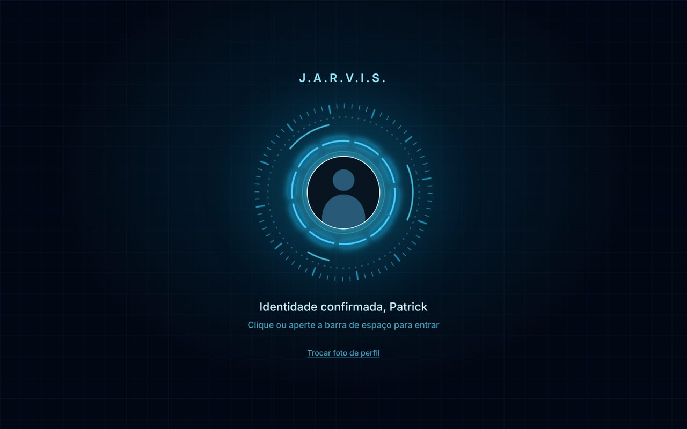 | 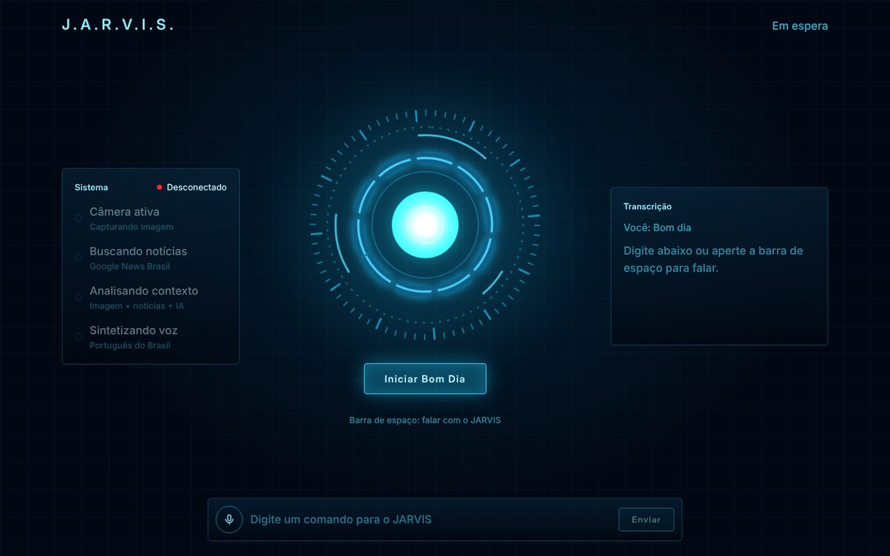 |
| **V2.1** · 01/10 | 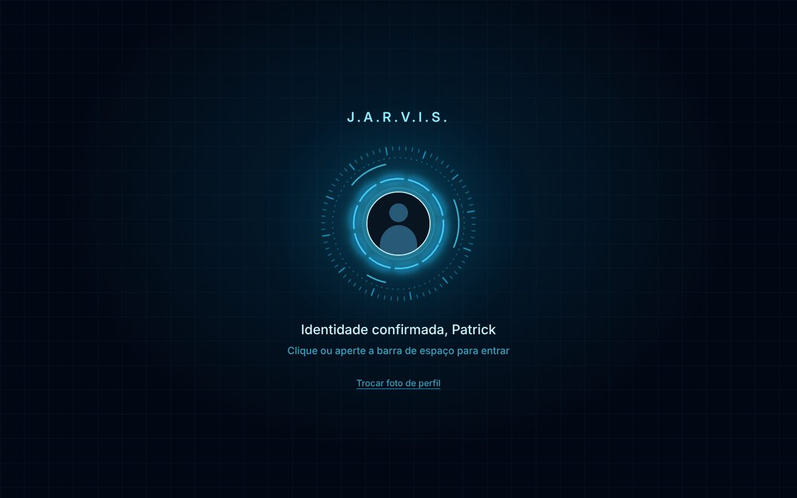 | 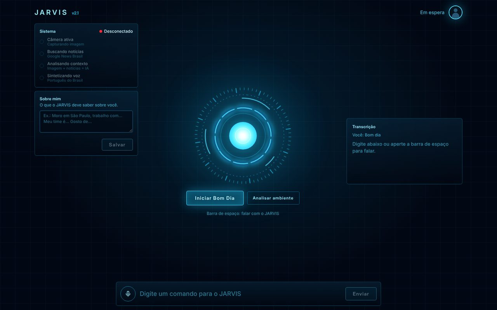 |
| **V2.2** · 07/10 | 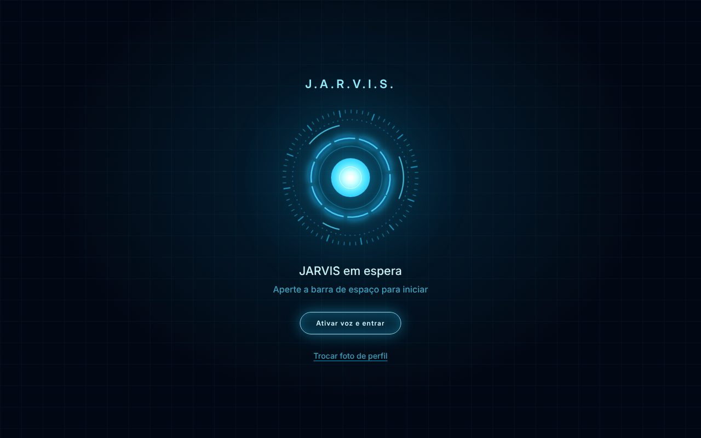 | 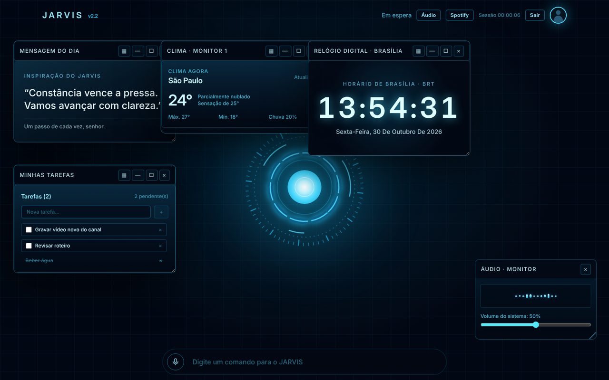 |
| **V3** · 20/10 | 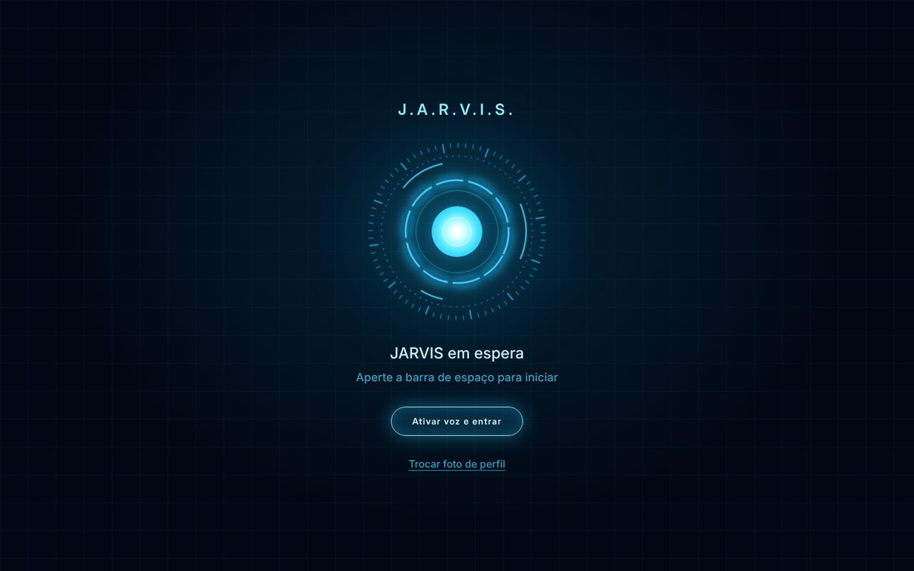 | 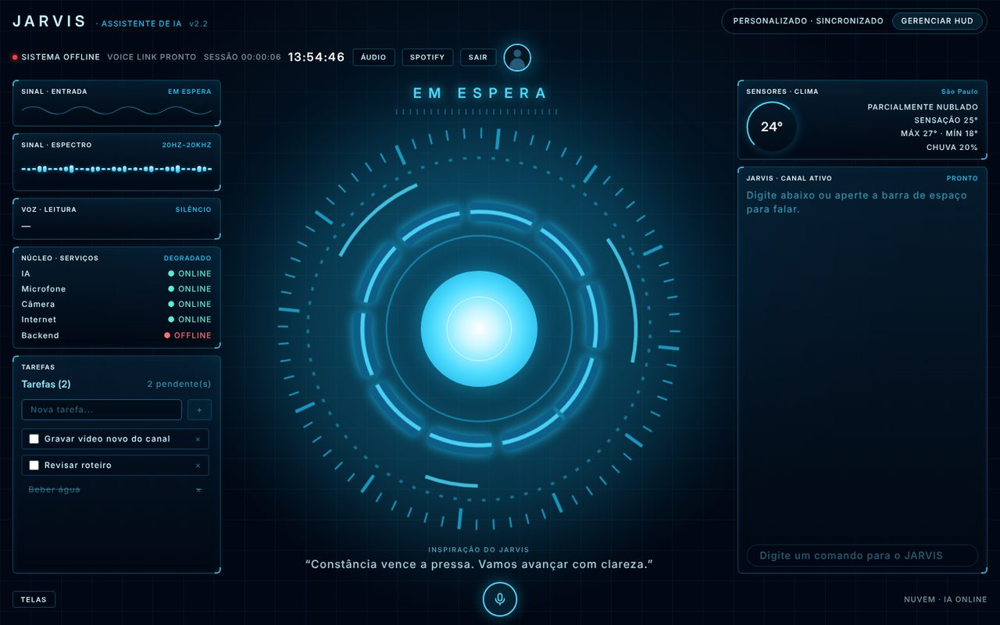 |
| **V4.0** · 28/10 | 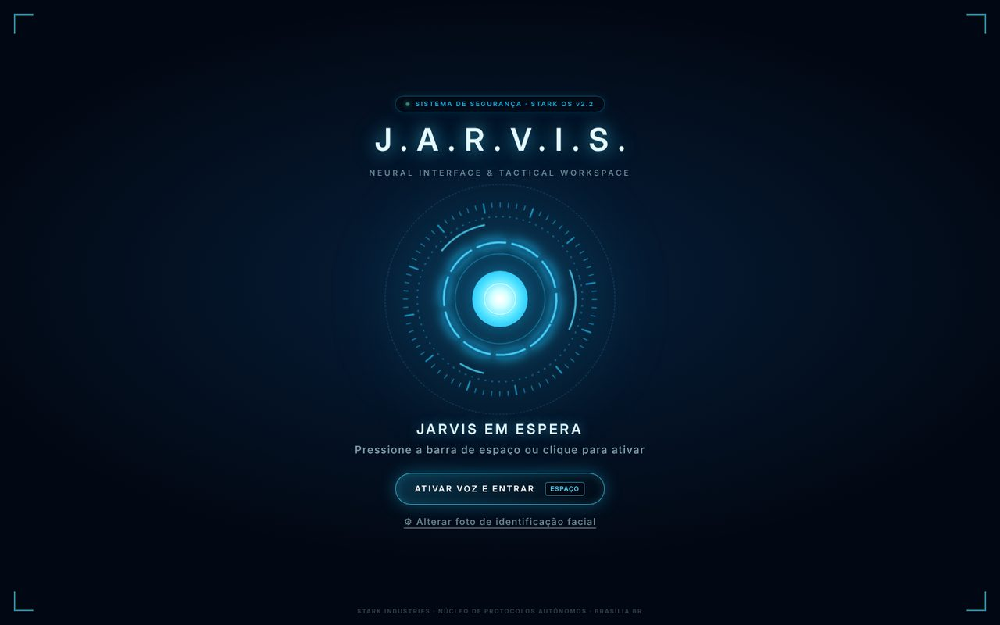 | 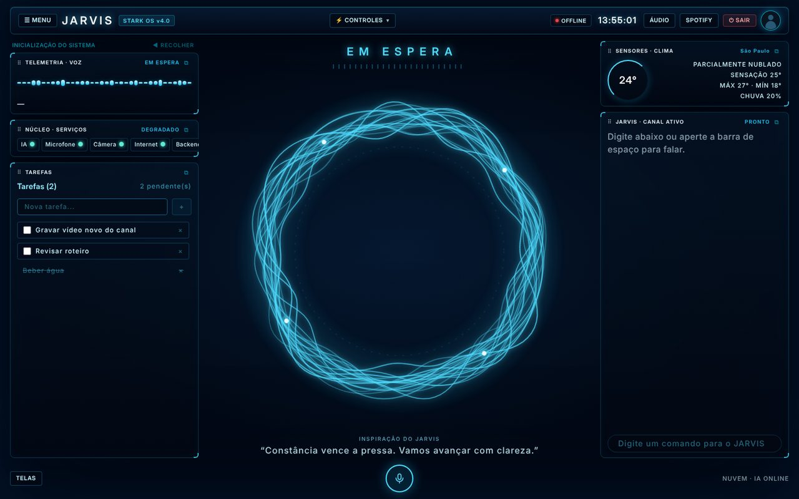 |
| **4.1** · 29/10 | 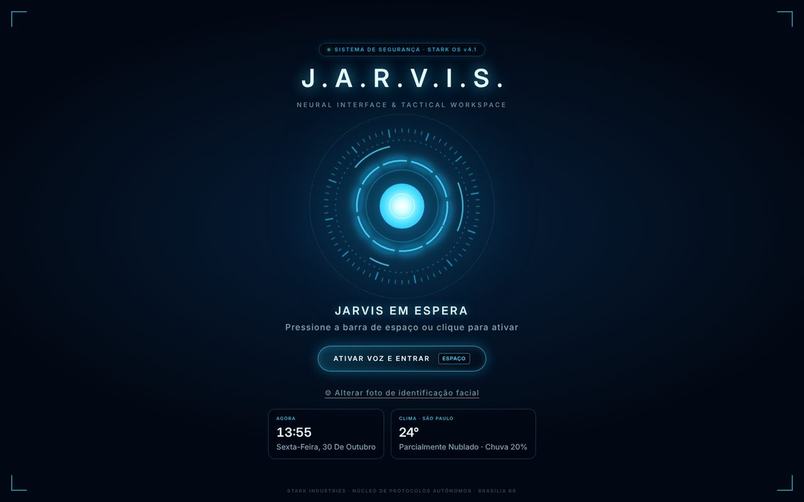 | 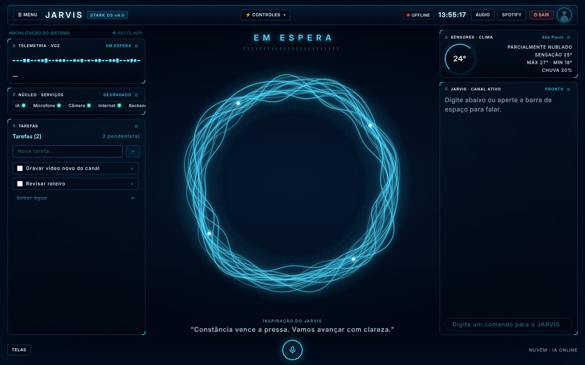 |

## Pendências

Nenhuma no momento.

---

*Escrito e desenvolvido por Patrick Souza.*
